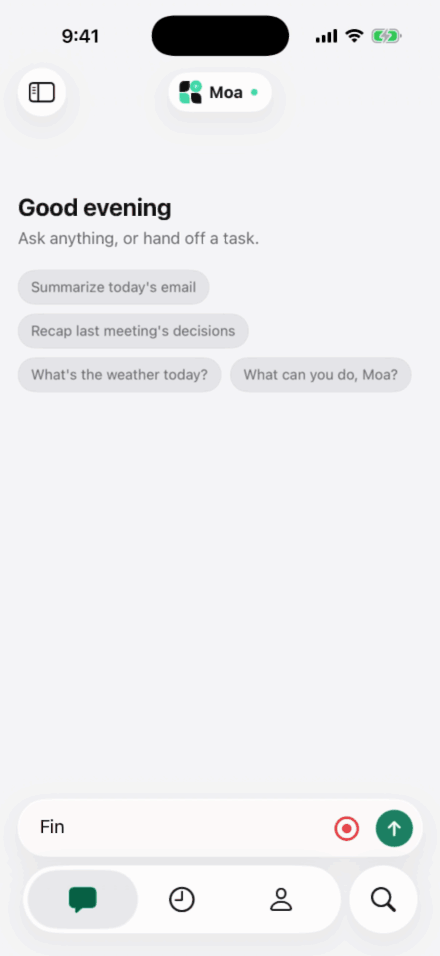
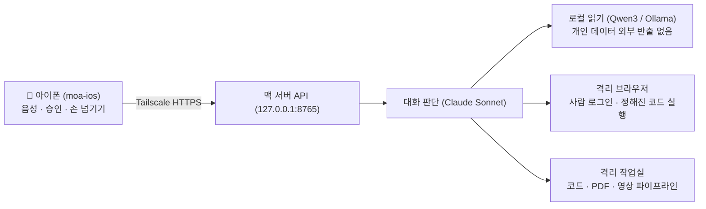
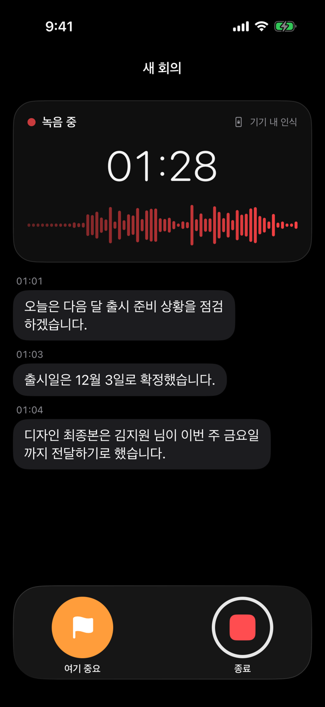
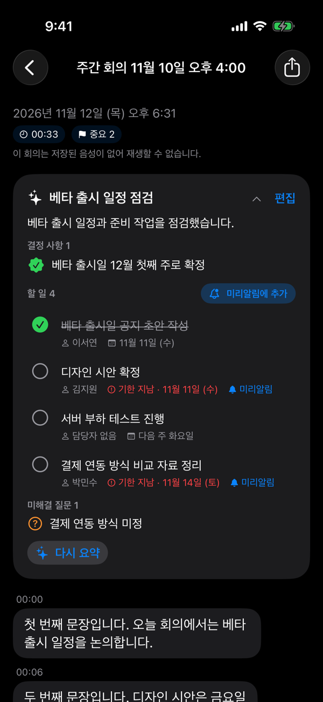
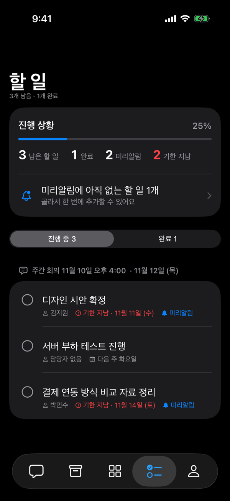
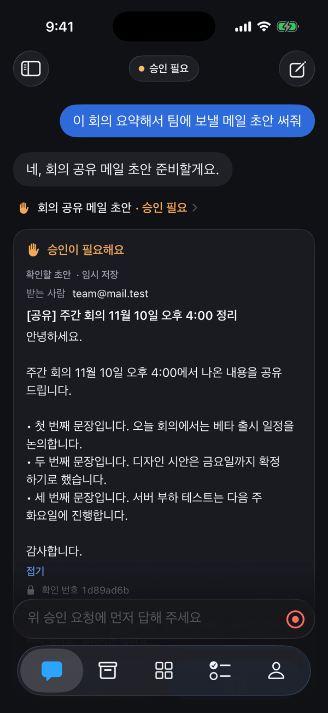
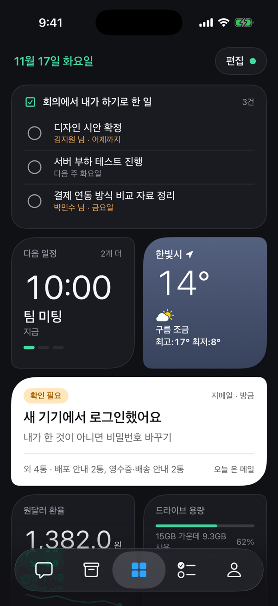

<div align="center">

# moa-agent

**내 맥에서 도는 셀프호스팅 개인 AI 비서 + 네이티브 iOS 앱**

하루 사용량 제한도, 내 메일·쿠키·비밀번호를 외부 클라우드에 맡길 필요도 없습니다.
실행은 집 맥이 맡고, 되돌릴 수 없는 결정은 아이폰에서 직접 승인합니다.

[English](README.md) · 한국어

[](LICENSE)
[](#설치-맥)
[](https://github.com/ijwoo/moa-ios)

<br/>

<picture>
  <source media="(prefers-color-scheme: dark)" srcset="docs/media/moa-demo-dark.gif">
  
</picture>

<sub>아이폰에서 요청 → 맥 브라우저가 작업 → 캡차 화면에서 멈춤 → 폰으로 화면을 넘겨 사람이 직접 해결 → 이어서 완료. (합성 데모 데이터)</sub>

</div>

---

## 왜 모아야 할까요?

대부분의 오픈소스 에이전트는 텔레그램 봇이나 웹 채팅에 머물러 있고, 로그인·결제가 걸리면 프롬프트에 시크릿이 섞이거나 그대로 막힙니다.

- **텔레그램 봇이 아닌 네이티브 iOS 앱** — [moa-ios](https://github.com/ijwoo/moa-ios)(SwiftUI)와 Tailscale로 연결되어 승인 카드, 실시간 화면 제어(손 넘기기), 기기 내 회의 녹음·요약까지 한 흐름으로 이어집니다.
- **모델을 거치지 않는 시크릿 & 손 넘기기** — 아이디·비밀번호·카드 값은 LLM 컨텍스트나 로그로 가지 않습니다. 캡차나 2단계 인증은 우회하지 않고 폰 화면으로 넘겨 사람이 직접 풉니다.
- **내 맥, 내 한도** — 개인 Claude API 키와 로컬 Qwen3(`Ollama`)를 조합해 돌립니다. 플랫폼 일일 한도 없이, 개인 데이터는 맥(`127.0.0.1`) 안에 머뭅니다.

---

## 구조



### 데이터 반출 경계

| 작업 | 모델 | 맥 밖으로 나가는 것 | 절대 나가지 않는 것 |
|---|---|---|---|
| 대화 판단 | Claude Sonnet | 대화 글, 결과 이름표 | 메일 본문, 쿠키, 비밀번호 |
| 정해진 사이트 읽기 | 로컬 Qwen3 (Ollama) | 없음 | 전부 맥 안 |
| 사이트 안에서 하기 | Claude Haiku | 현재 화면 글만 | 아이디·비밀번호·카드 |
| 작업실 (문서/영상) | Claude Sonnet | 사용자가 준 제작안 | 개인 자료 전부 |

외부로 나가는 데이터는 지시문(프롬프트)이 아니라 코드(`src/agent/api/cloud.py`)에서 직접 차단합니다.

---

## 빠른 시작 (Apple Silicon Mac)

```sh
git clone https://github.com/ijwoo/moa-agent.git && cd moa-agent
scripts/setup_mac.sh                 # colima, 브라우저 이미지, 가상환경, .env (작업실 포함 시 --with-workroom)
$EDITOR .env                         # ANTHROPIC_API_KEY 또는 로컬 모델 설정
.venv/bin/python -m agent.cli serve  # 127.0.0.1:8765 API 시작
```

- **로컬 모델(선택)**: `brew install ollama && ollama pull qwen3:14b`
- **아이폰 연결**: [Tailscale](https://tailscale.com) `tailscale serve`로 `127.0.0.1:8765`를 감싼 뒤, [moa-ios](https://github.com/ijwoo/moa-ios) 설정에 주소와 `AGENT_APP_TOKEN` 입력
- **로그인 시 자동 실행**: `scripts/install_autostart.sh install`

---

## 핵심 기능 및 측정

| 영역 | 하는 일 | 검증 결과 |
|---|---|---|
| **사이트 작업** | 로그인된 사이트에서 읽기·실행, 바꾸는 버튼은 폰 승인 카드 | 합성 68 / 70 |
| **손 넘기기** | 캡차·2단계 인증 시 멈추고 아이폰으로 실시간 조작 화면 전달 | 실기기 확인 |
| **기억** | 사용자 요약본(`md`) 유지 + 지난 대화 검색 | 합성 11 / 11 |
| **회의 → 실행** | 기기 내 음성 인식으로 요약 후 메일 초안·미리알림으로 연결 | 실기기 확인 |
| **작업실** | 격리 컨테이너에서 A4 보고서 PDF·그래프·영상 생성 | 격리 6 / 6 |

<details>
<summary>앱 화면 및 상세 측정 결과 보기</summary>

| 녹음 | 회의 요약 | 할 일 | 승인 카드 | 내 공간 |
|:---:|:---:|:---:|:---:|:---:|
|  |  |  |  |  |

- 공개 사이트 직접 조작: 쉬운 10/10 · 어려운 5/10 · 복잡한 화면(합성) 13/14
- 대화 판단 정확도: 84/84
- 작업실 A4 보고서 PDF 생성: 55초 · $0.12
- 전체 측정 조건과 실패 기록은 [docs/EVALUATION.md](docs/EVALUATION.md)에 있습니다.

</details>

---

## 문서

- [아키텍처](docs/ARCHITECTURE.md) — Provider, 도구 루프, 샌드박스, 보안
- [HTTP API](docs/API.md) — `moa-ios` 연동 명세
- [작업실 설계](docs/design/workroom.md) — 격리 구조와 위협 모델
- [평가 지표](docs/EVALUATION.md) — 합성·공개 사이트 측정 결과
- [로드맵](docs/ROADMAP.md) — Phase 1~8 진행 내역

## 라이선스

[MIT](LICENSE)
