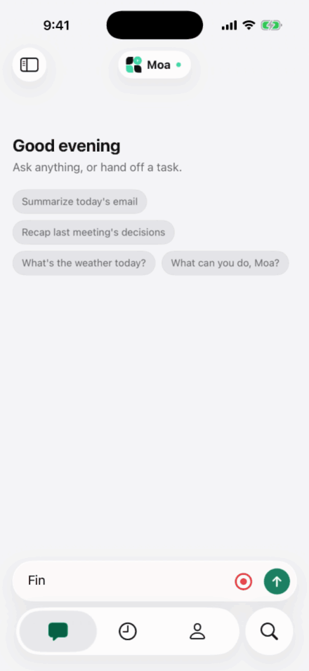
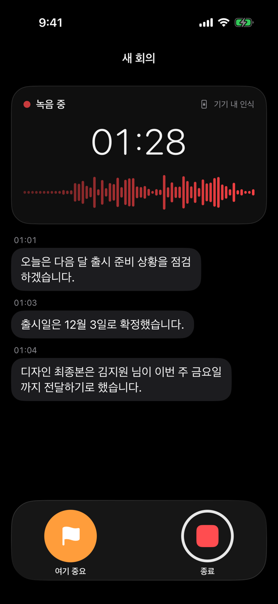
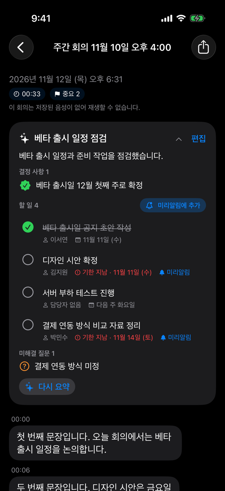
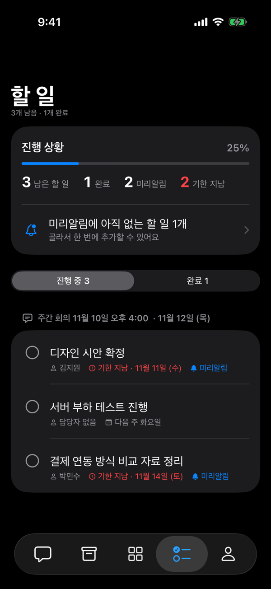
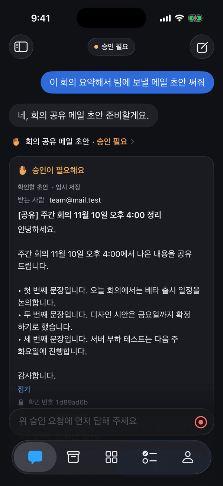
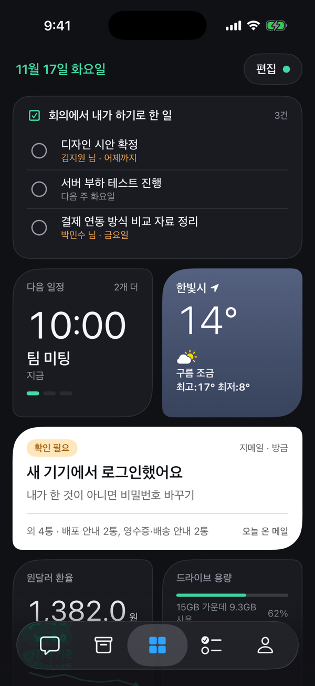
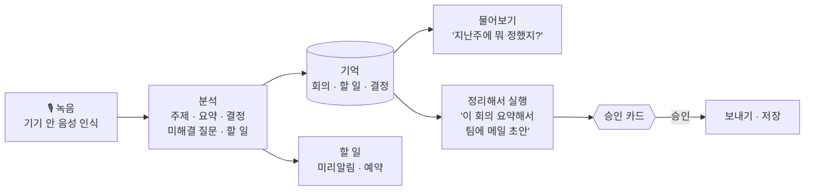
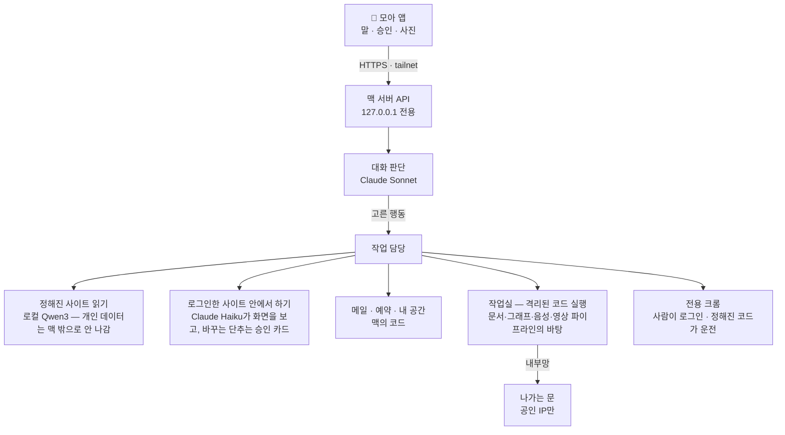
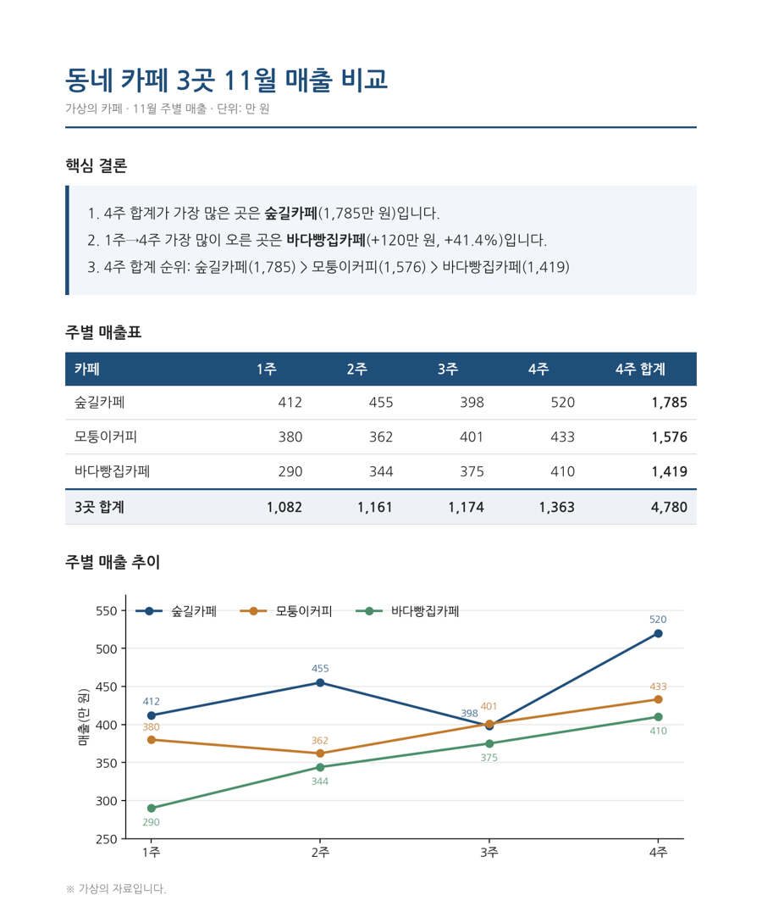

# moa-agent — 말로 부탁하면 맥이 대신 해 주는 개인 AI 비서

<p align="center"></p>

회의를 기억하고, 받은 메일을 정리하고, **로그인해 둔 사이트에서 일을 하고**, 정한 시각에 할 일을 챙기는 개인 비서의 맥 서버입니다.
폰 앱 [moa-ios](https://github.com/ijwoo/moa-ios)는 말과 승인만 주고받고, **실행은 모두 내 맥에서** 일어납니다.
모델은 무엇을 할지 *고르기만* 하고, 실제로 누르고 입력하는 것은 검증된 정해진 코드입니다.

- 🧠 **기억** — 대화에서 나에 대해 알게 된 것을 요약본(md)으로 쥐고, 지난 대화는 필요할 때 찾아 답한다
- 🖱 **실행** — 격리된 브라우저로 사이트를 열고 읽고 누른다. 바꾸는 단추는 폰의 승인 카드를 거친다
- 🙋 **사람과 함께** — 캡차·사람 확인은 우회하지 않고 폰으로 넘겨 사람이 직접 푼다(손 넘기기)
- 🧪 **측정으로 고친다** — 합성 사이트 70과제, 공개 사이트 20과제를 고칠 때마다 다시 잰다

> 1인 개발 프로젝트입니다. 맥(Apple Silicon) + 아이폰 조합을 기준으로 만들었습니다.

| 녹음 | 회의 분석 | 할 일 |
|:---:|:---:|:---:|
|  |  |  |
| **정리해서 실행 (승인 카드)** | **내 공간** | |
|  |  | |

<sub>화면은 모두 앱의 합성 데모 데이터입니다 — 실제 회의·메일·이름이 아닙니다.</sub>

---

## 회의 → 분석 → 정리



- **녹음과 분석은 앱** — 기기 안 음성 인식으로 전사하고, 중계 서버를 거쳐 요약·결정·할 일을 구조화합니다. 회의 원문은 기기에만 둡니다
- **정리와 실행은 엔진** — 사용자가 대화에 회의를 붙여 부탁하면, 맥이 그 자료로 메일 초안·예약·카드를 만듭니다. 바꾸는 일은 모두 승인 카드를 거칩니다
- **실제 회의 데이터는 평가·문서·커밋에 쓰지 않습니다** — 측정은 합성 회의로만 합니다

## 구조 — 판단은 클라우드, 실행은 맥



| 일 | 모델 | 나가는 것 | 안 나가는 것 |
|---|---|---|---|
| 대화 판단 | Claude Sonnet | 대화 글, 결과의 이름표 | 읽은 결과의 내용, 메일 주소, 쿠키 |
| 정해진 사이트 읽기 | 로컬 Qwen3 (Ollama) | 없음 | 전부 맥 안 |
| 공개 정보 검색 | Claude Haiku | 검색할 물음 한 문장 | 대화 기록 |
| 사이트 안에서 하기 | Claude Haiku | 그 화면의 글 | 아이디·비밀번호 |
| 작업실 | Claude Sonnet | 사용자가 준 대본·제작안 | 개인 자료 전부 |

모델은 성능보다 **그 일에 어떤 데이터가 실리는가**로 골랐습니다.
나가는 메시지는 함수 하나(`src/agent/api/cloud.py`의 `outgoing`)가 만들고, 개인 내용은 코드가 막습니다(지시문에 기대지 않습니다).

## 지키는 선

- **모델은 판단, 도구는 실행** — 모델 출력은 신뢰할 수 없는 입력입니다. 스키마와 입력 검증을 거친 정해진 도구만 실행합니다
- **승인 내용 = 실행 내용** — 승인한 초안은 해시로 고정하고, 누르기 직전에 화면을 다시 읽어 승인한 값과 다르면 누르지 않습니다
- **카드는 돌이킬 수 없는 지점 바로 앞에** — 예: 파일을 고르는 순간 상대 서비스에 초안이 생기는 흐름이면, 마지막 단추가 아니라 파일 선택 앞에서 묻습니다
- **숫자는 원문에 있는 것만** — 카드·해석에 원문에 없는 숫자가 들면 코드가 버립니다. 차이·추세도 코드가 계산합니다
- **막히면 멈춘다** — 캡차·2단계 인증·봇 차단을 우회하지 않고, 브라우저를 사람인 척 꾸미지 않습니다
- **로그인은 사람이** — 아이디·비밀번호는 저장하지 않고 모델 입력·기록·캡처에 넣지 않습니다
- **한 곳의 예외, 작업실** — 모델이 쓴 코드는 격리 컨테이너 안에서만 실행합니다. 문서·영상 같은 제작 파이프라인은 모두 이 바탕 위에 올라갑니다 → [설계](docs/design/workroom.md)

## 할 수 있는 것

| 기능 | 하는 일 | 상태 |
|---|---|---|
| 대화 | 답하기·되묻기(고르기 카드)·작업 만들기, 앞의 결과를 가리키는 말 잇기 | 실기기 사용 중 |
| 메일 | 받은 메일 브리핑, 본인·연락처에게 보내기(승인 카드) | 본인 발송 실기기 확인, 남에게는 합성 6/6 |
| 사이트 로그인 | 사람이 앱 카드로 입력, 소셜·QR·간편인증, 로그인 상태만 보관 | 실기기 확인 |
| 사이트 읽기·안에서 하기 | 로그인해 둔 사이트의 화면을 읽고 말한 일을 함 | 합성 69/70, 실사이트 일부 |
| 기억 | 나에 대한 요약본(md) + 지난 대화 검색, 보기·고치기·지우기 | 합성 11/11 |
| 끼어들기·함께 | 작업 중에도 대화, 도는 작업에 말 덧붙이기, 다른 작업 함께 | 합성 |
| 공개 정보 | 웹 검색 답, 공개 페이지 직접 열기, CSV·엑셀 내려받아 계산 | 공개 사이트 10/10 · 9/10 |
| 예약 | "매일 아침 8시에 …" — 정한 때에 그 말을 대신 건넴 | 실기기 사용 중 |
| 내 공간 | 말로 짜는 카드 화면, 지난번과 견준 변화 | 구성 42/42 · 채우기 16/16 |
| 작업실 | 격리된 코드 실행 — 그 위에 제작 파이프라인(문서·그래프·음성·영상)을 하나씩 올린다. 만든 결과는 모델이 직접 보고 검수 | 격리 6/6, 합성 과제 1/1 |

## 측정

| 항목 | 결과 |
|---|---|
| 로그인한 사이트 안에서 하기 (합성 플래너 35과제 × 2) | 69 / 70 |
| 기억 — 되묻지 않기·지난 대화 찾기·정리 (합성) | 11 / 11 |
| 대화 판단 (Claude, 가상 데이터) | 84 / 84 |
| 공개 사이트 직접 조작 (쉬운 / 조작 많은) | 10 / 10 · 9 / 10 |
| 내 공간 구성 / 채우기 | 42 / 42 · 16 / 16 |
| 작업실 격리 시험 | 6 / 6 |
| 작업실 첫 합성 과제 (그림 3장 + 나레이션 → 세로 영상) | 75초 · $0.12 |
| 작업실 문서 과제 (가상 자료 → A4 보고서 PDF, 표·그래프·결론 3줄, 숫자 검산) | 55초 · $0.12 |

<p align="center"></p>

측정 조건과 실패 기록은 [docs/EVALUATION.md](docs/EVALUATION.md)에 있습니다.

## 설치 (맥)

```sh
git clone https://github.com/ijwoo/moa-agent && cd moa-agent
scripts/setup_mac.sh                 # colima·브라우저 이미지·가상환경·.env (작업실까지: --with-workroom)
$EDITOR .env                         # 쓸 기능만 켠다. Claude를 쓰면 ANTHROPIC_API_KEY를 직접 넣는다
.venv/bin/python -m agent.cli serve  # 앱용 API (127.0.0.1:8765)
```

- 로컬 모델(Qwen3)을 쓰면: `brew install ollama && ollama pull qwen3:14b`
- 맥에 로그인하면 서버가 스스로 뜨게: `scripts/install_autostart.sh install`
- **폰에서 붙기**: 서버는 `127.0.0.1`에만 열립니다. 같은 [tailnet](https://tailscale.com) 안에서 `tailscale serve`로 감싸고, 앱 설정에 그 주소와 `.env`의 `AGENT_APP_TOKEN`을 넣습니다
- 사이트 로그인은 사람이 앱의 카드로 합니다(아이디·비밀번호는 맥에 저장하지 않습니다)

```sh
.venv/bin/pytest                                     # 단위 테스트
RUN_INTEGRATION=1 .venv/bin/pytest                   # 컨테이너 포함
.venv/bin/python scripts/bench_inside.py --set all   # 사이트 안에서 하기 측정(합성 사이트)
```

## 폴더

```text
src/agent/
├── api/          앱용 HTTP API · 대화 판단 · 작업 담당 · 카드 · 예약 · 내 공간
├── providers/    ModelProvider — Claude · Qwen(Ollama), 응답 형식 정규화
├── core/         에이전트 루프 · 승인 · 검증
├── tools/        도구 정의 · 입력 검증
├── browser/      브라우저 세션 · 전용 크롬
├── sites/        사이트 로그인 · 읽기 · 안에서 하기 · 공개 길
├── mail/         메일 읽기·보내기 (키체인)
├── memory/       회의·할 일·결정 기억
└── workroom/     작업실 — 격리 컨테이너 · 나가는 문 · 정해진 운전 코드
browser_service/  컨테이너 안 브라우저 서비스
docker/workroom/  작업실 이미지 · 나가는 문(프록시)
skills/           기능 하나 = 파일 하나 (앱 카드와 모델 지시)
site_hints/       사이트별 요령 (권한을 넓히지 못함)
scripts/          측정 스크립트
```

## 문서

코드 주석의 `D번호`(예: D106)는 개발하면서 남긴 결정 기록의 번호입니다. 결정 기록과 개발 회고는 개인 사용 맥락이 많아 이 저장소에는 넣지 않았습니다.


- [docs/ARCHITECTURE.md](docs/ARCHITECTURE.md) — 구성 요소, Provider·도구·루프·샌드박스, 보안
- [docs/API.md](docs/API.md) — 앱용 HTTP API 명세
- [docs/EVALUATION.md](docs/EVALUATION.md) — 평가 지표와 측정 결과
- [docs/ROADMAP.md](docs/ROADMAP.md) — Phase 1~8
- [docs/design/workroom.md](docs/design/workroom.md) — 작업실 설계와 위협 모델

## 라이선스

[MIT](LICENSE)
