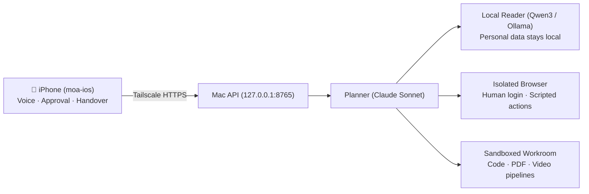

<div align="center">

# moa-agent

**Self-hosted personal AI assistant on your Mac, with a native iOS app.**

No daily usage caps. No third-party cloud holding your emails, cookies, or passwords.
Your Mac runs the browser and tasks; your iPhone approves what matters.

English · [한국어](README.ko.md)

[](LICENSE)
[](#quick-start)
[](https://github.com/ijwoo/moa-ios)

<br/>

<picture>
  <source media="(prefers-color-scheme: dark)" srcset="docs/media/moa-demo-dark.gif">
   live phone handover -> approval & result card">
</picture>

<sub>Command from iPhone → isolated Mac browser works → hits CAPTCHA → hands live screen to your phone → resumes after you solve it. (Synthetic demo store)</sub>

</div>

---

## Why Moa?

Most open-source personal agents live inside a Telegram bot or web chat, store API secrets in plain `.env` files alongside prompts, and break on real-world logins.

- **Native iOS App, Not a Chat Bot** — Paired with [moa-ios](https://github.com/ijwoo/moa-ios) (SwiftUI) over Tailscale: approval cards, live browser handover, on-device meeting transcription, and a dedicated space for generated files.
- **Zero-Secret LLM Routing** — Credentials never enter the LLM context or server logs. Sensitive fields are injected directly; CAPTCHAs and 2FA are handed live to your phone screen instead of brittle bypasses.
- **Your Mac, Your Limits** — Run with your own Claude API key and/or local Qwen3 (`Ollama`). No platform daily quotas, and personal data stays inside your Mac (`127.0.0.1`).

---

## Architecture



### Data & Privacy Boundary

| Task | Model | Leaves Your Mac | Never Leaves |
|---|---|---|---|
| Planning & Routing | Claude Sonnet | Chat text, result labels | Mail body, cookies, credentials |
| Site Reading | Local Qwen3 (Ollama) | Nothing | Everything stays on Mac |
| In-Site Actions | Claude Haiku | Current page text only | IDs, passwords, cards |
| Workroom (Code/PDF) | Claude Sonnet | User prompt & script | All personal records |

Outgoing payloads are enforced in code (`src/agent/api/cloud.py`), not by prompt instructions alone.

---

## Quick Start (Apple Silicon Mac)

```sh
git clone https://github.com/ijwoo/moa-agent.git && cd moa-agent
scripts/setup_mac.sh                 # Colima, browser image, venv, .env (add --with-workroom for sandbox)
$EDITOR .env                         # Add ANTHROPIC_API_KEY and/or enable local models
.venv/bin/python -m agent.cli serve  # Starts local API on 127.0.0.1:8765
```

- **Local model (optional)**: `brew install ollama && ollama pull qwen3:14b`
- **Connect your iPhone**: Expose `127.0.0.1:8765` inside your [Tailscale](https://tailscale.com) tailnet with `tailscale serve`, then set the URL and `AGENT_APP_TOKEN` in [moa-ios](https://github.com/ijwoo/moa-ios).
- **Auto-start on login**: `scripts/install_autostart.sh install`

---

## Core Capabilities

| Area | What it does | Verified |
|---|---|---|
| **Browser Tasks** | Reads and acts inside logged-in sites; irreversible clicks require phone approval | 68 / 70 synthetic tasks |
| **Live Handover** | Pauses at CAPTCHA / 2FA and streams the interactive view to iPhone | Real device |
| **Memory** | Maintains user summary (`md`) + searchable episode history | 11 / 11 synthetic |
| **Meeting -> Action** | Turns on-device meeting transcripts into drafts, reminders, and follow-ups | Real device |
| **Workroom** | Isolated container for generating PDF reports, charts, and media | 6 / 6 isolation checks |

<details>
<summary>App Screens & Full Benchmark Details</summary>

| Record | Summary | Todos | Approval Draft | Space |
|:---:|:---:|:---:|:---:|:---:|
|  |  |  |  |  |

- Public site automation: `10/10` (standard), `5/10` (hard sites), `13/14` (complex synthetic screens)
- Planner routing accuracy: `84/84`
- Workroom PDF report generation: `55s · $0.12`
- See [docs/EVALUATION.md](docs/EVALUATION.md) for full methodology and failure logs.

</details>

---

## Documentation

- [Architecture](docs/ARCHITECTURE.md) — Providers, tool loop, sandbox, and security model
- [HTTP API](docs/API.md) — Endpoints consumed by `moa-ios`
- [Workroom Design](docs/design/workroom.md) — Container isolation & threat model
- [Evaluation](docs/EVALUATION.md) — Synthetic & public benchmarks
- [Roadmap](docs/ROADMAP.md) — Phase 1–8 progress

## License

[MIT](LICENSE)
