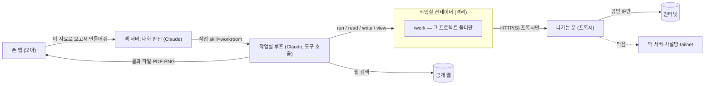
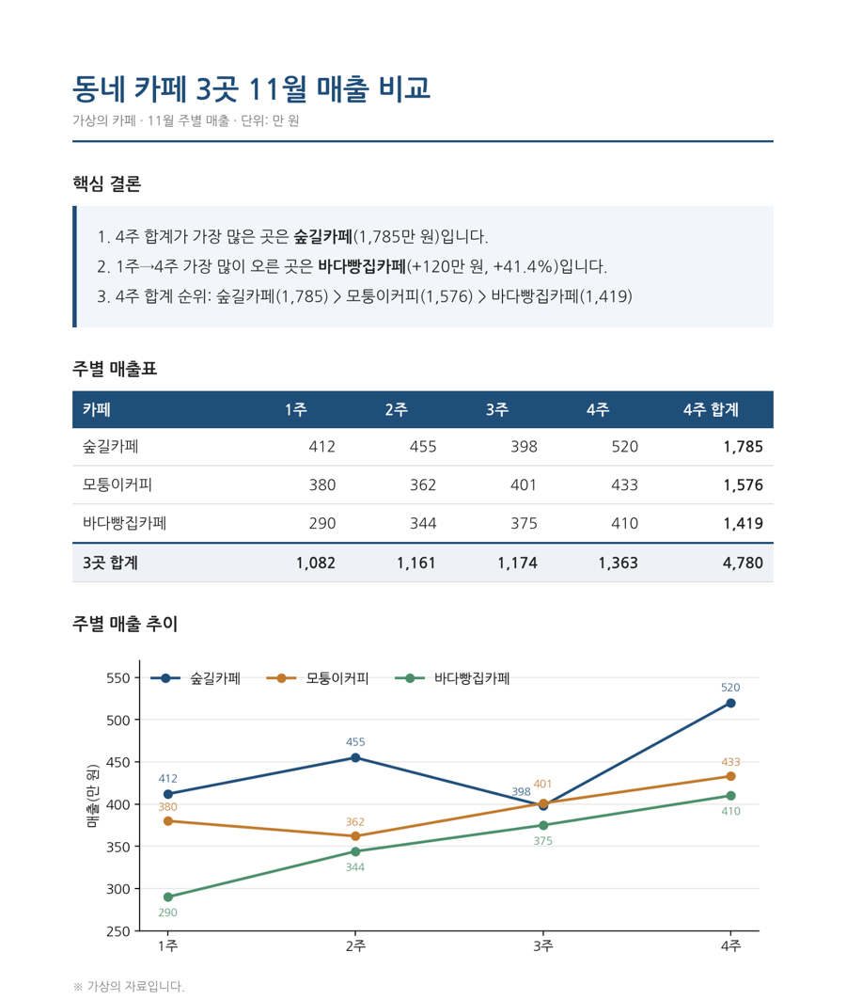

# 작업실 (Workroom) — 모델이 코드를 짜서 실행하는 격리된 방

> 결정 D96 (2026-11-17). 상태: 1·2·5단계 완료(격리 시험, 작업실 루프, 문서·화면 시안 과제). 결과를 폰으로 보내는 것은 앱 쪽.

## 1. 왜 필요한가

"이 자료로 한 쪽짜리 보고서 만들어 줘", "이 숫자로 그래프 그려 줘", "이 화면을 이렇게 바꾼 시안 보여 줘" —
이런 부탁은 정해진 도구 몇 개로는 폭이 모자란다. 사람이라면 표를 계산하는 스크립트를 짜고, 그래프를 그리고,
HTML로 문서를 짜서 PDF로 뽑고, 찍어 본 뒤 글자가 겹친 곳을 고친다. 모델도 같은 길로 일하게 하려면
**모델이 셸 명령과 파이썬 스크립트를 직접 써서 실행하는 자리**가 필요하다.

이 엔진의 원칙 3번은 "모델은 판단, 도구는 실행 — 모델이 셸 명령을 만들어 실행하지 않는다"이다.
메일·로그인·키체인·결제 근처를 다루기 때문에 일부러 정한 선이다.

결정: 원칙 3번에 **한 곳의 예외**를 둔다 — *작업실 안에서만* 모델이 만든 명령을 실행한다.
설계의 전부는 이 예외가 작업실 밖으로 새지 않게 하는 것이다.

## 2. 구조

| 구성 요소 | 하는 일 | 위치 |
|---|---|---|
| 작업실 컨테이너 | 모델이 만든 명령을 실행. 파이썬(pillow·numpy·matplotlib)·한글 글꼴·Chromium(HTML → PDF·PNG)·ffmpeg | `docker/workroom/` |
| 나가는 문(프록시) | 작업실의 유일한 바깥 길. 이름을 풀어 **공인 IP일 때만** 잇는다 | `docker/workroom/egress_proxy.py`, 같은 이미지·다른 컨테이너 |
| 작업실 관리자 | 컨테이너를 띄우고·명령을 넣고·시간·출력 상한을 건다 | `src/agent/workroom/manager.py` |
| 작업실 루프 | Claude가 도구를 골라 일을 끝까지 한다. 만든 그림을 직접 보고(view_image) 검수. 비용·시간 상한 | `src/agent/workroom/loop.py` |

## 3. 지키는 선 (위협 모델)

| 위험 | 막는 법 | 확인 방법 |
|---|---|---|
| 작업실이 비밀에 닿는다 | `.env`·API 키·키체인·로그인 프로필·메일·회의 자료를 **넣지 않는다.** 마운트는 프로젝트 폴더 하나(`/work`). Claude API는 컨테이너 밖(맥 서버)에서 부른다 | 통합 테스트: 환경 변수·파일시스템에 비밀 없음 |
| 맥 서버·집 네트워크를 건드린다 | 작업실은 **바깥 길이 없는 내부망**(`--internal`)에만 붙는다. 나가는 길은 프록시 하나, 프록시는 사설·루프백·링크로컬·CGNAT(tailnet)·멀티캐스트 주소로 잇지 않는다(이름을 푼 뒤 그 IP로 직접 잇는다 — DNS 재바인딩 방지) | 통합 테스트: host.docker.internal·게이트웨이·192.168/10/100.64 접속 실패, 공인 https는 성공 |
| 컨테이너를 빠져나간다 | 비루트 사용자, 모든 권한(capability) 제거, no-new-privileges, 루트 파일시스템 읽기 전용, Docker 소켓 없음 | 통합 테스트: 사용자·권한 확인 |
| 폭주(무한 반복·큰 비용·디스크 채우기) | 메모리 2GB·CPU 2·프로세스 512·명령 하나 10분·작업 하나 60분·출력 잘라 보내기·Claude 비용 상한(작업마다, 넘으면 멈추고 알림) | 통합 테스트: 메모리·시간 상한에서 끊김 |
| 브라우저로 사이트를 몬다 | 작업실은 하지 않는다. 안의 Chromium은 `/work`의 HTML을 PDF·PNG로 찍는 데만 쓴다. 로그인한 사이트 일은 작업실 밖의 '사이트 안에서 하기'(승인 카드)로만 | 설계 |
| 웹에서 받은 글이 모델을 속인다 | 작업실에는 훔칠 비밀도, 보내는 도구(메일·게시)도 없다 | 설계 |
| 숫자를 지어낸다 | 계산은 코드로 하고, 문서의 숫자가 자료와 맞는지 모델이 다시 확인한다(지침) | 결과 검토 |
| 저작권 | 남의 사진·그림은 공개 라이선스(퍼블릭 도메인·CC0 등)가 확인된 것만, 출처를 결과에 남긴다 — 지침 | 결과 검토 |

남는 위험(받아들인 것): 작업실 안의 파일(공개 자료와 사용자가 부탁에 붙인 자료)은 프록시를 통해 바깥으로 나갈 수 있다 — 그래서 개인 자료를 작업실에 넣지 않는다(사용자가 그 부탁에 직접 붙인 것만 `/work/input/`에).

## 4. 단계와 완료 기준

| 단계 | 내용 | 완료 기준 | 상태 |
|---|---|---|---|
| 1 | 이미지·나가는 문·관리자·격리 시험 | 위 "확인 방법"의 통합 테스트 모두 통과 | ✅ 7/7 |
| 2 | 작업실 루프(Claude 도구 호출) | 합성 과제를 끝까지, 비용·시간 측정 | ✅ |
| 3 | 결과 전달 | 맥 → 폰 결과 파일(PDF·PNG, 앱 쪽) | |
| 5 | 문서·화면 시안 | 부탁 한 문장(+붙인 자료)에서 끝까지, 스스로 검수 포함 | ✅ 보고서 1/1 · 화면 시안 |

## 5. 측정

| 날짜 | 무엇 | 결과 |
|---|---|---|
| 2026-11-17 | 이미지 `local-ai-agent/workroom` | python 3.12 slim + ffmpeg + 나눔·Noto CJK + pillow·numpy·matplotlib·requests, 0.2에서 Chromium 추가(1.88GB) |
| 2026-11-17 | 격리 시험 `RUN_INTEGRATION=1 pytest tests/integration/test_workroom.py` | 7/7 — uid 1100·CapEff 0·읽기 전용, 환경 변수·마운트에 비밀 없음, 직접 나가기 실패(ENETUNREACH), 프록시가 `host.docker.internal:8765`·192.168.5.2·192.168.0.1·10.0.0.1·100.100.100.100·127.0.0.1·localhost·169.254.169.254·비표준 포트를 막고 공인 https(example.com)는 200, 2초 상한·2GB 메모리·출력 자르기 |
| 2026-11-17 | 화면 시안(D104) | `shot`으로 HTML → 1170×2532 PNG. 붙인 화면을 보고 시안 2개 41초·$0.11 → 이어서 고치기 23초·$0.05 |
| 2026-11-19 | **문서 과제** `scripts/bench_workroom.py --task doc` (claude-sonnet-5-5) | completed, 10걸음(실패 1 — 스스로 고침), **55초, $0.12**. 가상 자료(카페 3곳 × 4주)로 A4 1쪽 PDF — 결론 3줄·주별 표(합계 행)·선 그래프. 합계·증가율·순위는 코드로 계산, 표·결론의 숫자 모두 자료와 일치(사람이 다시 계산해 확인). 그래프의 숫자 라벨 겹침을 스스로 세 번 고침 |

